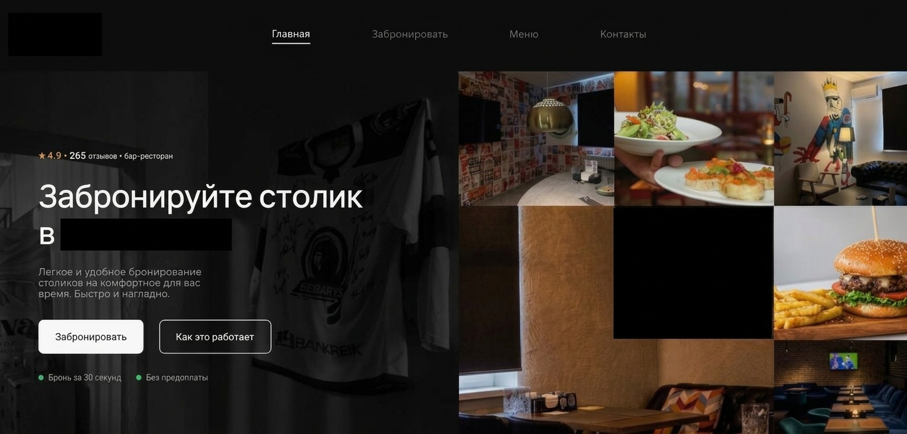

# Table Reservation System

**An interactive restaurant table booking experience.**

A web-based restaurant reservation project focused on visual table selection and a convenient booking experience.

## Preview

<!-- Add project screenshots here -->

  

  

## Highlights

- Interactive restaurant floor plan
- Visual table selection
- Multiple table selection
- Zoom and pan navigation
- Responsive mouse and touch interactions
- User-focused interface design

## Tech Stack

`TypeScript` · `Tailwind CSS` · `Vite` · `HTML`

## About the Project

The project explores how an interactive visual interface can simplify the restaurant reservation process.

Instead of relying only on traditional booking forms, users can interact directly with the restaurant layout and select tables visually.

## My Contribution

**Frontend Development & UI/UX Design**

- Designed and implemented frontend interfaces.
- Worked on interactive restaurant floor plan components.
- Implemented table selection interactions.
- Integrated frontend functionality with backend API endpoints.

## Developer

**Adil Khalelov**

[GitHub](https://github.com/Akdh-a) · [LinkedIn](https://www.linkedin.com/in/akdh060867)
